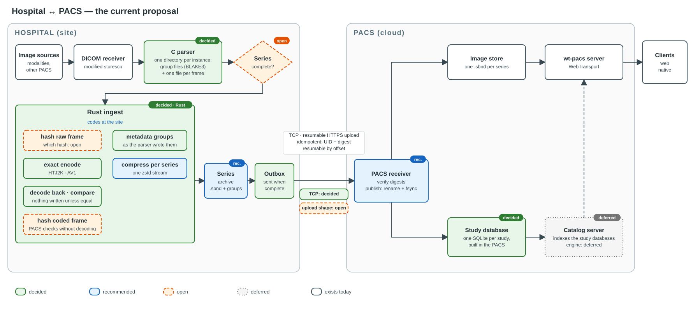

# Ingest — from the hospital to the PACS

The target shape of everything between a hospital's image sources and the PACS, and the one place every decision about
it is listed. The reasoning lives in the files linked from §6; this file says what the system does and where each
choice stands.

*Corrected 2026-10-26* against [`pacs-receive-design.md`](pacs-receive-design.md), the design state of 2026-10-24/25:
this repository's scope **starts at the PACS** (decided 2026-10-24). Steps 1–5 below and the link are the **PCS's
side** — the hospital-side component, another team's — kept here as the input the PACS expects, not as work this
repository designs. The interface between the two is the **submission package** (one file per series, or a small
update package; its XXH3 in its name). Hashes the PACS checks are XXH3, not BLAKE3.

## 1. The flow

**At the hospital: the PCS's side.**

1. **Receive.** Image sources (modalities, other archives) send DICOM to a receiver: dcmtk's `storescp`, modified to
   run the parser once per received instance.
2. **Parse.** The owner's C parser writes one directory per instance: the exam, series, instance and private
   attributes as key-value group files, each named by its hash (BLAKE3-256 in the parser read on 2026-10-11; XXH3,
   decided 2026-10-24/25; *corrected 2026-10-28:* XXH3 in wt-pacs's contract, the PCS keeps BLAKE3 by its team's choice), and one raw file per frame. That directory is
   the hand-over: a crash checkpoint, inspectable, and a process boundary between C reading untrusted files and the
   ingest.
3. **Wait for the series.** DICOM marks no last instance, so the ingest needs a rule for when a series is complete
   (open, §4).
4. **Ingest (Rust).** Per frame: hash the raw samples, encode them exactly (HTJ2K or AV1), decode the result back and
   compare, and hash the coded bytes. Nothing is written unless every frame is equal. The metadata groups are kept as
   the parser wrote them and compressed together, one zstd stream per series.
5. **Outbox.** One submission package per series (the `.sbnd` plus its metadata groups) waits in the PCS's outbox
   until it is complete and checked, and is deleted only when the PACS confirms it "stored".

**On the link, the PCS's sender.** TCP: a resumable HTTPS upload, resumable by offset (proposed:
[`link.md`](link.md) §11, [`../adr/pcs-transfer.md`](../adr/pcs-transfer.md) §3).

**At the PACS: this repository's scope.**

6. **Receive and verify.** The receiver checks the package's and the frames' digests, writes into a staging
   directory, `fsync`s, reads back from disk, publishes by rename, and replies "stored" or "refused" (proposed:
   [`pacs-receive-design.md`](pacs-receive-design.md) §3).
7. **Store.** The `.sbnd` joins the image store the server already reads.
8. **Index.** The PACS keeps one study DB per study (SQLite format) from the metadata groups, so bad data in one study
   never forces rebuilding another. The study index, derived from the study DBs, lists studies and series
   ([`../adr/study-index.md`](../adr/study-index.md), proposed).
9. **Serve.** The wt-pacs server streams frames to web and native clients, which check each frame's digest before
   painting it.

## 2. The integrity chain

| hash | over | written by | checked by | proves |
| --- | --- | --- | --- | --- |
| XXH3-64 | the raw samples, as read | the ingest | the ingest after decode-back; the client after its decode | the coded frame, and the shown one, is the encoder's input |
| coded-frame digest (XXH3-64, in the agreed draft target; not built) | the coded bytes | the ingest | the PACS on receipt, read back from disk; the server on read | transit and storage, without decoding |
| XXH3 (*corrected 2026-10-26*: this row said BLAKE3-256) | a metadata group | the parser | the PACS, after decompressing | parser → PACS for metadata, once the parser hashes the bytes it writes (§5; *corrected 2026-10-28:* it does since `e105214`, with BLAKE3, its team's choice) |
| XXH3, in the package's name | the submission package | the PCS | the PACS on receipt | the link and the PCS's disk |
| TLS | the bytes on the wire | — | — | the link alone |

The client's checks stay on by default.

## 3. Failure and recovery

* **A bad frame** fails the series at the PCS: nothing is sent. Storing the good instances and marking the series
  incomplete is the alternative (open).
* **A cut upload** resumes from its offset; a repeated one changes nothing. A known series UID with a new digest is a
  new revision; what happens to the old one is open.
* **A publish** is a rename after `fsync`: readers see the whole series or none of it.
* **A bad study DB** is rebuilt from its groups without touching any other study; the study index is rebuilt by
  scanning the study DBs.

## 4. Decisions

| decision | status | where it is argued |
| --- | --- | --- |
| The ingest is written in Rust | **decided** 2026-10-11 | [`../FIXTURES.md`](../FIXTURES.md) §A compiled ingest at the site |
| The parser's directory output is the hand-over, to start | **decided** 2026-10-11 | [`design.md`](design.md) §3 |
| The link is TCP; a QUIC shipper is dropped until research shows a gain | **decided** 2026-10-11 | [`link.md`](link.md) |
| One SQLite database per study (the study DB), built in the PACS | **decided** 2026-10-11 | [`design.md`](design.md) §5 |
| A database server indexes the study DBs: the study index | **decided** 2026-10-11; named and specified 2026-10-25, proposed | [`design.md`](design.md) §5; [`../adr/study-index.md`](../adr/study-index.md) |
| Scope starts at the PACS; the PCS's output is the input contract | **decided** 2026-10-24 | [`pacs-receive-design.md`](pacs-receive-design.md) §1 |
| The client's exactness checks stay on by default | **decided** 2026-10-11 | [`../adr/exactness-in-production.md`](../adr/exactness-in-production.md) |
| Frames are coded at the PCS | the PCS's side: the PACS receives coded `.sbnd`s and does no repacking (decided 2026-10-24/25) | [`design.md`](design.md) §2 |
| One submission package per series on the link; its XXH3 in its name | **decided** 2026-10-25; *reopened 2026-10-28* (the PCS row below) | [`pacs-receive-design.md`](pacs-receive-design.md) §2 |
| Metadata compressed one stream per series | configurable per site; the receiver accepts both (owner, 2026-10-26); frames never compressed again (decided 2026-10-25) | [`design.md`](design.md) §7; [`pacs-receive-design.md`](pacs-receive-design.md) §2 |
| Publish by rename after `fsync`; idempotent by UID + digest | recommended | [`design.md`](design.md) §8 |
| When a series is complete; what a late instance does | open | [`design.md`](design.md) §4 |
| The raw-frame check is the XXH3-64 already written for the client | **decided** 2026-10-12 | [`design.md`](design.md) §6 |
| A digest of the coded bytes | **agreed** in the draft target (2026-10-12), XXH3-64 in each entry, not built; checking it on every read stays optional (*corrected, queue row DOCFIX, 2026-10-13*: this line said open) | [`../disk-layout/target.md`](../disk-layout/target.md) §The two hashes; [`../adr/exactness-in-production.md`](../adr/exactness-in-production.md) §8 |
| A changed duplicate: replace, keep both, or hold | open | [`design.md`](design.md) §8 |
| A bad instance: refuse the series, or store the rest marked incomplete | open | [`design.md`](design.md) §8 |
| The upload's shape (S3-style multipart, tus, per-file PUT, rsync) | open; a resumable HTTPS upload proposed | [`link.md`](link.md) §7, §9; [`../adr/pcs-transfer.md`](../adr/pcs-transfer.md) §3 |
| The PCS sends one file a series (the `.sbnd` in it), not a tree; hashes are XXH3; the PACS confirms storage before the PCS deletes; a second refusal goes to an operator | **decided** 2026-10-24/25; *corrected 2026-10-28:* one file, not a tree, reopened by the team (rsync and a trigger after it); XXH3 is ours, the PCS keeps BLAKE3 (the design state, `pacs-receive-design.md`, #168) | [`../adr/pcs-transfer.md`](../adr/pcs-transfer.md) §1 |
| The PCS host's tuning and congestion controller (the PCS's side); the server's kernel | open | [`link.md`](link.md) §4, §9 |
| How the parser ships with the ingest | open | [`../FIXTURES.md`](../FIXTURES.md) §A compiled ingest at the site |
| The parser hashes the bytes it writes | **fixed upstream** at `e105214` (`e21160f`; *corrected 2026-10-28:* this row said open) | §5 below |
| Streaming the pack: code on arrival; frames as records only under a quiet period | recommended | [`design.md`](design.md) §11 |
| The study index's engine | MySQL proposed; "MySQL fits" (owner, 2026-10-25), its placement to evaluate | [`../adr/study-index.md`](../adr/study-index.md) §5 |
| The PACS receiver and builder: one program beside the server, the inputs kept, revisions named by `CURRENT` | recommended 2026-10-21; superseded by the receiver ADR (`docs/adr/pacs-receiver.md`, #163) | [`design.md`](design.md) §12 |

## 5. Parser findings

Read from the parser's public source for the ingest's input contract. Phase 1 does not act on them; they are for the
parser's author.

* **Planar configuration (0028,0006) is never read**, so a colour frame stored plane by plane is written plane by plane
  with nothing saying so.
* **Three of the four group hashes cover a length taken before the UTF-8 conversion** (series, instance, private; the
  exam group's is right). A group whose text changed length in the conversion fails a recompute while intact.
  *Corrected 2026-10-28:* fixed upstream at `e105214` (`e21160f` hashes the bytes actually written).
* **Frame files are named with five digits**, so a series over 99 999 frames cannot be written.
* **The variable `comp` holds samples per pixel (0028,0002)**, though its comment says planar configuration.

## 6. Where the details live

* [`design.md`](design.md) — each part of this pipeline against its alternatives, with the prior art.
* [`link.md`](link.md) — why the link is TCP, and what QUIC would have to show.
* [`contract.md`](contract.md) — the parser's directory output as the ingest reads it, and what phase 1 reads of it.
* [`../FIXTURES.md`](../FIXTURES.md) §A compiled ingest at the site — today's Python ingest and the plan for the
  compiled one.

## 7. What is built, in order

Each step is in the product unless it says otherwise; its numbers are in its queue row (`docs/av1/queue.md` on
`claude/av1-mainbase`).

1. **One Python ingest for both codecs** (row 52, 2026-10-07): `ingest/coded-frames/ingest.py` codes HTJ2K or AV1,
   decodes each frame back in-process and refuses any frame not equal to its source.
2. **One command from DICOM to a served bundle** (row 89, 2026-10-09): `ingest/from-dicom/from_dicom.py`, with the
   display attributes, a digest per frame and the codec chosen per series. This is the ingest the product runs today.
3. **The compiled ingest planned** (rows 126 and 136, 2026-10-10 and 11): Rust, the parser integrated in stages; the
   profile showed HTJ2K's ingest CPU is mostly not the encoder, so CPU is a reason to compile it
   ([`../FIXTURES.md`](../FIXTURES.md) §A compiled ingest at the site).
4. **The pipeline designed** (rows 153 and 154, 2026-10-11): [`design.md`](design.md) and [`link.md`](link.md), theory
   only. What was decided from them is in §4.
5. **The Rust ingest, phase 1** (row 155, 2026-10-12): `ingest/from-parser` reads the parser's directory output (a
   Python mirror stands in for the parser) and writes `.sbnd` files byte-identical to the Python ingest's on all 88
   lab sets, HTJ2K only. The gate keeps the two equal. The raw-frame check moved to XXH3-64.
6. **DICOM to `.sbnd` in the gate** (row 226, 2026-10-14): a synthetic CT and RGB series through `from_dicom.py`, every
   frame read back out of the bundle and compared with the samples it was written from.

**Not built.** Phase 2 of the Rust ingest (AV1, several instances a series, the parser's own output instead of the
mirror), and everything after the ingest in §1: the outbox and the upload (the PCS's side), the PACS's receiver, the
study DBs and the study index. None of it is queued yet; when a series is complete (§4) has to be decided before the outbox can be.
